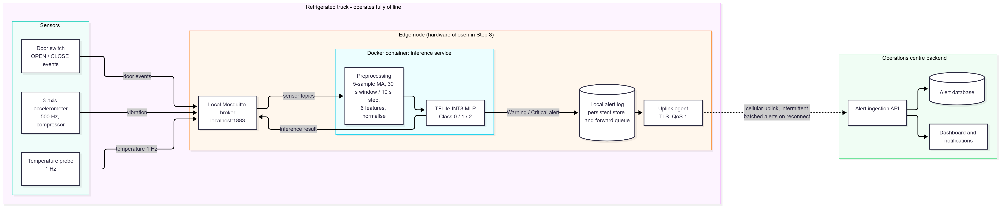

# LogiEdge: Edge AI for Cold-Chain Trucks

AIML ZG535 Machine Learning on Edge — mini-project (EC-I), Group 15.

| BITS ID | Name | Contributions |
|---|---|---|
| 2025ae05381 | Disha Shetty H | 100% |
| 2025ae05382 | Murali Krishna Sai Garisapati | 100% |
| 2025ae05420 | Rajan Yadav | 100% |
| 2025ae05680 | Santosh Kumar Behera | 100% |

LogiBridge (project title: LogiEdge) classifies simulated refrigerated-truck conditions as **Normal, Warning or Critical** using temperature and vibration features. Door transitions are separately logged. The system performs inference locally while the operations centre can be unreachable.

- Final report: [`reports/final_report.pdf`](reports/final_report.pdf) — **review its older measurements and deployment wording against the latest run before submission**.
- Demo instructions: [`demo/README.md`](demo/README.md).
- Demo video: **add the final recording URL before submission** (not included in this archive).

## Architecture



1. `data_pipeline/simulator.py` generates temperature (1 Hz), vibration (0.5 Hz) and door events; publishes them to Mosquitto MQTT.
2. `inference/inference_service.py` subscribes, performs 5-point moving averages, overlapping 30-second windows / 10-second steps and six-value feature fusion, normalizes using `training_stats.npy`, and invokes TFLite.
3. Critical alerts are written locally to JSONL; door state changes are logged separately. `inference/alert_sync.py` retries delivery via HTTP, tracking acknowledgments in SQLite. `operations_centre/server.py` deduplicates alert IDs in its SQLite database.
4. `monitoring/drift_monitor.py` separately subscribes to inference messages and calculates PSI on the **Normal-class probability (`p_normal`)**; it also reports stale inference streams.
5. A Docker registry supplies versioned images. The seven-task Ansible playbook deploys a selected model and matching PSI reference. The demo starts an operations-centre and sync helper in separate containers; **those helpers are not deployed by the seven-task playbook itself**.

**Network note:** The repeatable demonstration uses the Docker network `logibridge-net` and a Mosquitto container named `mosquitto` (no host port mapping); it is separate from any WSL system Mosquitto service. The development broker allows anonymous connections **only on the isolated demo network**.

## Repository layout

| Path | Purpose |
|---|---|
| `scenario_architecture/` | Constraint analysis, calculator and architecture diagram |
| `hardware/` | Edge-device selection, Roofline and fleet-cost calculations |
| `data_pipeline/` | Simulator, preprocessing, MQTT design and normalization stats |
| `training/` | Dataset generation, 6→32→16→3 MLP, FP32/INT8 conversion, 35% structured-pruning experiment |
| `inference/` | MQTT inference, lightweight TFLite runner, Dockerfile, local alert sync, OTA bandwidth calculator |
| `operations_centre/` | HTTP receiver and SQLite deduplication |
| `monitoring/` | PSI monitor and M2 baseline reference |
| `deployment/` | Seven-task Ansible playbook, Docker Mosquitto config, OTA-strategy calculations, earlier run evidence |
| `optimisation/` | Three-variant CPU benchmark, latest CSV/chart and model recommendation |
| `demo/` | Guided runner, cleanup script and model-comparison view |
| `tests/` | Alert synchronization and idempotency-focused automated test |
| `reports/` | Phase reports and final report; may need refreshing after latest experiments |

## Environment (tested setup)

Windows + WSL2 Ubuntu, Docker Desktop with Ubuntu WSL integration, Python **3.11** in `.venv`, Mosquitto Docker image, Ansible and `community.docker` collection. Your local environment also has traditional `/usr/bin/sudo.ws` because the WSL distribution's default `sudo-rs` timed out under Ansible.

```bash
cd ~/projects/logibridge
# If .venv already exists, do not recreate it:
source .venv/bin/activate
python --version
docker info >/dev/null
ansible-playbook --version
ansible-galaxy collection list community.docker
```

For a new machine, set up Python 3.11 first, create `.venv` with `uv venv --python 3.11 .venv`, install dependencies with `uv pip install -r requirements.txt` inside the activated environment, and install Ansible plus its Docker collection. Do not copy your `.venv` between machines.

## Full end-to-end demo (recommended)

The tested runner is the authoritative way to perform the complete Docker/MQTT/Ansible demo, avoiding inconsistent hostnames and file paths:

```bash
cd ~/projects/logibridge
source .venv/bin/activate
bash demo/demo_runner.sh prep
bash demo/demo_runner.sh all
# Or: bash demo/demo_runner.sh all --auto
```

`all` already includes `prep`; the separate `prep` command is optional. The guided runner covers architecture, sensor/preprocessing check, validation, M3 OTA image build, Ansible M3 deployment + a `changed=0` second run, live MQTT/PSI/offline-synchronization, benchmarking and OTA economics. It may ask for your Ubuntu sudo password.

To start a new demo **without old alert records**, first inspect and run the dedicated cleanup script; it preserves Git, model artifacts, image cache, registry and broker:

```bash
bash demo/demo_cleanup.sh --dry-run
bash demo/demo_cleanup.sh    # type RESET DEMO to confirm deletion of demo runtime data
bash demo/demo_runner.sh all
```

The cleanup deletes `runtime_data/demo/` and the `logibridge-data` Docker volume; archive evidence externally before using it. See [`demo/README.md`](demo/README.md) for stage-by-stage commands, rollback and status checks.

### Model identity and deployment

- M1 FP32: `training/models/mlp_fp32.tflite`.
- **M2 PTQ INT8**, baseline: `training/models/mlp_int8.tflite`, SHA-256 prefix `52ee32f1`. Tracked `inference/model.tflite` in this ZIP matches M2.
- **M3 structured-pruned INT8**, recommended and verified during guided demo: `training/models/mlp_pruned_int8.tflite`, SHA-256 prefix `84ff2345`.
- Stage 4 builds local image `1.1` with M3. Stage 5 deploys M3 **and its model-specific PSI reference** via Ansible into `/opt/logibridge` while keeping the source-tree M2 model/reference untouched. The container uses `MODEL_PATH=/opt/logibridge/model.tflite`.
- `bash demo/demo_runner.sh rollback` restores M2 model/reference/image 1.0; the playbook is **not an automatic health-triggered rollback controller**.

## Latest benchmark artifact in this repository ZIP (1 November 2026)

Source: `optimisation/results/benchmark_results.csv`; laptop WSL CPU, 28 W CPU TDP assumption, five trials, 200 timed calls/trial after 10 warmups; 57 **synthetic** held-out validation windows.

| Variant | Mean latency (ms) | P95 (ms) | Model (KB) | Accuracy | Critical recall | Estimated energy (mJ) |
|---|---:|---:|---:|---:|---:|---:|
| M1 FP32 | 0.000971 | 0.001022 | 5.19 | 100% | 100% | 0.0016987 |
| M2 PTQ INT8 | 0.000923 | 0.000977 | 3.38 | 100% | 100% | 0.0016144 |
| M3 Pruned+INT8 | 0.000922 | 0.000970 | 2.94 | 100% | 100% | 0.0016131 |

These values are copied from `optimisation/results/benchmark_results.csv` in this ZIP, not from previous terminal screenshots. The figures are **per-run measurements**, and microsecond-scale latencies fluctuate with the host. All three models achieved 100% accuracy and 100% Critical recall on the synthetic validation set only; **not** evidence of equivalent performance on real trucks. Energy is an estimate from assumed TDP and process CPU share, **not a power-meter reading**. M3 has the smallest file (2.94 KB), 400 parameters, 366 MACs and 545-byte tensor memory; it is the memory-focused recommendation rather than a guaranteed fastest variant.

## OTA and management evidence

- Guided demo: M2 image `1.0` → M3 image `1.1`, local registry manifest-layer comparison. Results are generated by `python inference/ota_bandwidth.py --old 1.0 --new 1.1`; values depend on the registry images and should **not** be copied from the archived `deployment/ota_bandwidth_m3.txt` without checking its older tag/digests.
- `deployment/ota_strategy_cost.py` uses **assumed 280 KB** model, 85 trucks, ₹0.10/MB and a six-week release cycle. Canary rollout (10 first, then 75) is **a proposed strategy**, not an implemented fleet orchestrator.
- Ansible second deployment reached `changed=0`; local `localhost` target only, **not 85 physical edge devices**.
- Guided live demo verified Critical alerts retained during operations-centre unavailability and acknowledged after restart; drift alerts were observed. Offline PSI check demonstrated recovery; a full 100-window live recovery was **not** demonstrated.
- Historic `deployment/run*.txt`, `deployment/ota_bandwidth_m3.txt`, and `reports/*.pdf` may refer to earlier experiment settings and image tags. Treat them as archived evidence, not the latest demo metrics.

## Limitations and safety boundaries

- All sensors and freight conditions are simulated; no actual Raspberry Pi/MCU, refrigerated truck, modem or cellular coverage transition was tested.
- The simulated drift of +0.08 °C per temperature reading is deliberately steep; synthetic classes are relatively separable. Feature z-scores are clipped at ±10.
- The benchmark uses WSL CPU, not physical edge-device latency or measured electrical energy. The container's lightweight TFLite wheel is platform-specific and should not be presumed compatible with ARM without rebuilding/replacing the runtime.
- PSI on `p_normal` monitors **prediction-score shift**, not confirmed real sensor-data drift, model accuracy decline or a causal hardware fault. Stale inference **is** monitored.
- Offline HTTP retry and deduplicated storage were demonstrated; the simulated outage stops the operations-centre container (its hostname becomes unavailable), **not** a physical cellular link.
- The demo's MQTT broker and operations-centre HTTP receiver have no production-grade authentication/TLS. Keep them isolated; do not expose to public networks or use sensitive operational data.
- Rollback and canary/shadow promotion are design/command-level capabilities, not automatic fleet-wide governance. Retaining the previous model on **each truck** was not demonstrated; rollback via Ansible redeployment is supported in the local demo.

## Reproducibility and submission

The training, baseline and drift-reference seeds are documented in source scripts; see `training/`, `monitoring/`, and `NOTES.md`. Validate the final PDF and demo video separately; the presence of this README or the local demo logs does not mean those submission artifacts have been updated.
