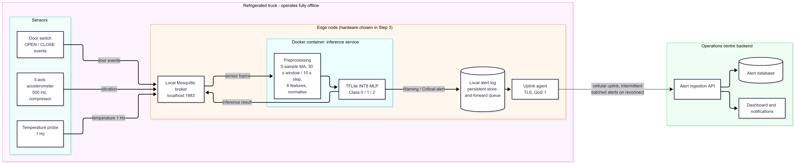

# LogiEdge: Edge AI for Cold-Chain Trucks

AIML ZG535 Machine Learning on Edge, mini-project (EC-I). Group: <GROUP NO>. Authors: <NAMES AND IDs>.

LogiEdge classifies the cargo compartment of a refrigerated truck as Normal, Warning or Critical
on the truck itself, from temperature, compressor vibration and door events, so alerts keep
working during cellular coverage gaps. All sensor data is simulated.

- Demo video: <VIDEO LINK> (also in `demo/demo_video_link.txt`)
- Final report: `reports/final_report.pdf`

## Architecture


Sensors publish to a local Mosquitto broker (bound to 127.0.0.1). A Docker container runs
preprocessing and TFLite inference, publishes results and alerts back to the broker, and writes
a local alert log. Syncing alerts to the operations centre is part of the design only; the
uplink agent is not implemented.

## Repository layout
| Path | Contents |
|---|---|
| `scenario_architecture/` | constraint analysis, bandwidth calculation, architecture diagram |
| `hardware/` | hardware justification, Roofline and fleet-cost scripts |
| `data_pipeline/` | sensor simulator, preprocessing, normalisation stats, MQTT design |
| `training/` | dataset generation, training, TFLite conversion (M1, M2), pruning (M3), 3-sigma experiment |
| `inference/` | inference service, Dockerfile, deployed model, OTA bandwidth calculator |
| `monitoring/` | PSI drift monitor and reference distribution |
| `deployment/` | Ansible playbook, OTA strategy cost analysis, run outputs |
| `optimisation/` | benchmark, Pareto chart, deployment recommendation |
| `reports/` | Phase 1, Phase 2 and final reports |
| `demo/` | demo video link |

## Environment
Developed on Windows with WSL2 (Ubuntu) and Docker. Python 3.11 is required: tensorflow-model-
optimization 0.8.0 needs Python 3.11 or older, TensorFlow 2.15.1 and tf_keras 2.15.1.

```bash
uv venv --python 3.11 venv && source venv/bin/activate
uv pip install -r requirements.txt
apt install -y python3-docker          # used by Ansible's community.docker modules
ansible-galaxy collection install community.docker   # if not already present
```

## Running it
Broker and network (stop any apt Mosquitto first: `service mosquitto stop`):
```bash
docker network create logibridge-net
docker run -d --name mosquitto --network logibridge-net -p 127.0.0.1:1883:1883 eclipse-mosquitto:2 \
  sh -c 'printf "listener 1883\nallow_anonymous true\n" > /tmp/m.conf && exec /usr/sbin/mosquitto -c /tmp/m.conf'
```
Simulator and preprocessing:
```bash
python data_pipeline/simulator.py --anomaly {none|temp_drift|vibration|combined} [--anomaly-after S] [--anomaly-until S] [--speed N]
python data_pipeline/preprocessing.py compute-stats      # writes training_stats.npy (10 min clean data)
python data_pipeline/preprocessing.py live               # features from live MQTT
```
Training and conversion:
```bash
python training/generate_dataset.py
python training/train_model.py                           # gate: validation accuracy > 88%
python training/convert_ptq.py                           # M1 (FP32 TFLite), M2 (INT8 PTQ)
python training/stats_shift_experiment.py                # mandatory 3-sigma experiment
python training/prune_quantise.py                        # M3 (pruned + INT8)
python optimisation/benchmark.py --tdp-w <CPU TDP>
```
Container, registry and OTA demo:
```bash
docker build -f inference/Dockerfile -t logibridge-inference:1.0 .
docker run -d --name registry -p 127.0.0.1:5000:5000 registry:2
docker tag logibridge-inference:1.0 localhost:5000/logibridge-inference:1.0 && docker push localhost:5000/logibridge-inference:1.0
python inference/ota_bandwidth.py --old 1.0 --new 1.1     # after building and pushing 1.1
```
Drift monitoring and deployment:
```bash
python monitoring/drift_monitor.py build-reference
python monitoring/drift_monitor.py monitor               # PSI every 60 s over the last 100 inferences
python data_pipeline/simulator.py --anomaly combined --anomaly-after 600 --anomaly-until 1200 --duration 2700 --speed 10 --quiet
ansible-playbook -i localhost, deployment/logibridge_deploy.yml -e image_tag=1.0
```
Set `MODEL_PATH` on the container to switch model variants without a rebuild.

## Results (measured)
| Item | Result |
|---|---|
| Held-out validation accuracy | 100% on 57 windows (gate: 88%); Critical recall 100% |
| Model sizes (M1 / M2 / M3) | 5.19 / 3.38 / 2.94 KB; parameters 803 / 803 / 400; MACs 752 / 752 / 366 |
| Latency per inference (laptop, 1 thread) | about 2.3-2.4 microseconds for all three variants (within noise) |
| Roofline (brief's figures) | arithmetic intensity 2.50 FLOP/byte, ridge 1.33, compute-bound |
| OTA layer-cache demo | model layer about 4 KB against a 120.65 MB compressed image; 85 trucks: 0.35 MB against 10,255 MB |
| PSI drift demo | 0.000 before, peak 5.648 during, 0.000 after recovery (alert threshold 0.25) |
| Ansible | second run: changed=0 |
| OTA strategy | canary (10 trucks first) recommended |
| Deployed model | M3 (pruned + INT8) |

## Design decisions and limitations
- The "confidence" for PSI is the probability of the Normal class: max-softmax stays near 1.0 for every class on this data, so PSI on it cannot detect the fault.
- The simulated classes are trivially separable once features are clipped, so 100% accuracy is not evidence of real-world performance.
- The drift anomaly follows the brief (+0.08 C per reading, about 4.8 C/min), which is much steeper than a real refrigeration failure.
- Normalised features are clipped to +/-10; without the clip the FP32 model fails on out-of-range inputs.
- The drift monitor does not detect missing inference data (it keeps reporting its last window).
- The uplink agent is not implemented. Hardware selection (Raspberry Pi 5 + AI HAT+) is analysis only; all measurements ran on a laptop, and energy is derived (P x t).
- The container's tflite-runtime wheel is x86_64 only.

## Reproducibility
Seeds: normalisation stats 42, dataset 101/102/103, drift reference 202, training 0. The pruning
script patches a rank bug in tensorflow-model-optimization 0.8.0 (documented in the script).
