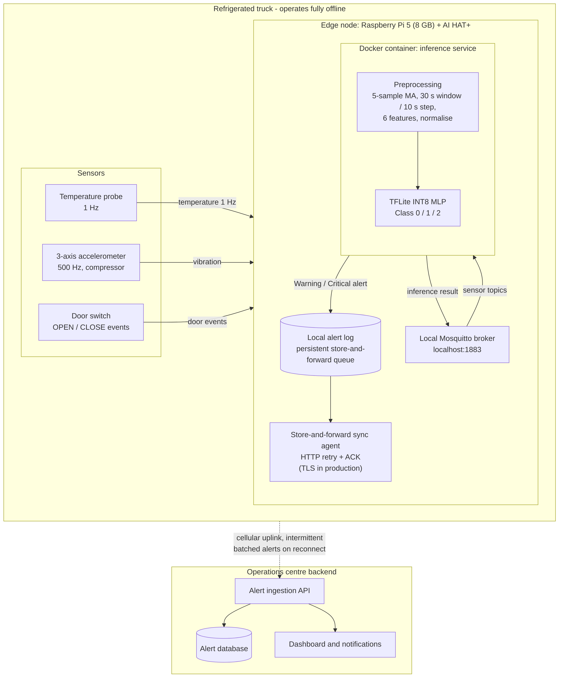

# LogiEdge: Edge AI for Cold-Chain Trucks

AIMLZG535 Machine Learning on Edge, mini-project (EC-I), Group 15.

| BITS ID | Name | Contributions |
|---|---|---|
| 2025ae05381 | Disha Shetty H | 100% |
| 2025ae05382 | Murali Krishna Sai Garisapati | 100% |
| 2025ae05420 | Rajan Yadav | 100% |
| 2025ae05680 | Santosh Kumar Behera | 100% |

LogiEdge (repository name: logibridge) classifies simulated refrigerated-truck conditions as Normal, Warning or Critical from temperature and vibration features, on the truck itself. Door transitions are logged separately. Inference and alert logging keep working while the operations centre is unreachable, and queued alerts are delivered when it comes back.

- Final report: [`reports/final_report.pdf`](reports/final_report.pdf)
- Demo video: see [`demo/demo_video_link.txt`](demo/demo_video_link.txt)
- Demo instructions: [`demo/README.md`](demo/README.md)

## Architecture



1. `data_pipeline/simulator.py` publishes temperature (1 Hz), vibration RMS (0.5 Hz) and door events to Mosquitto.
2. `inference/inference_service.py` subscribes to the sensor topics, applies 5-sample moving averages, builds 30-second windows every 10 seconds, extracts the six fused features, normalises them with `training_stats.npy` and runs the TFLite model.
3. Warning and Critical alerts are written to a local JSONL log. `inference/alert_sync.py` retries delivery over HTTP and records acknowledgements in SQLite; `operations_centre/server.py` stores alerts and ignores duplicate IDs.
4. `monitoring/drift_monitor.py` subscribes to the inference topic and computes PSI on the Normal-class probability (`p_normal`). It also reports when inference messages stop arriving.
5. A local Docker registry holds versioned images. The seven-task Ansible playbook deploys a chosen model and its PSI reference. In the demo, the operations centre and sync agent run as separate helper containers, outside the playbook.

The demo uses the Docker network `logibridge-net` and a Mosquitto container named `mosquitto`, with no host port mapping, so it is separate from any Mosquitto service installed in WSL. The broker allows anonymous connections because it is only reachable on that isolated network.

## Repository layout

| Path | Purpose |
|---|---|
| `scenario_architecture/` | Constraint analysis, bandwidth calculator and architecture diagrams |
| `hardware/` | Edge-device selection, Roofline and fleet-cost calculations |
| `data_pipeline/` | Simulator, preprocessing, MQTT design and normalisation statistics |
| `training/` | Dataset generation, 6-32-16-3 MLP, FP32/INT8 conversion, 35% structured pruning |
| `inference/` | MQTT inference service, TFLite runner, Dockerfile, alert sync, OTA bandwidth calculator |
| `operations_centre/` | HTTP receiver with SQLite de-duplication |
| `monitoring/` | PSI monitor and reference distribution |
| `deployment/` | Seven-task Ansible playbook, Mosquitto configuration, OTA strategy costs |
| `optimisation/` | Three-variant benchmark, results CSV, Pareto chart and model recommendation |
| `demo/` | Guided demo runner, cleanup script and model-comparison script |
| `tests/` | Alert sync and idempotency test |
| `evidence/` | Full terminal log of the 4 November run, plus earlier runs under `archive/` |
| `reports/` | Phase 1, Phase 2 and final reports (PDF and Word) |

## Environment

We tested on Windows with WSL2 Ubuntu, Docker Desktop (Ubuntu WSL integration on), Python 3.11 in `.venv`, the Mosquitto Docker image, Ansible and the `community.docker` collection. On our machine the default `sudo-rs` timed out under Ansible, so the runner uses `/usr/bin/sudo.ws` for privilege escalation.

```bash
cd ~/projects/logibridge
source .venv/bin/activate
python --version
docker info >/dev/null
ansible-playbook --version
ansible-galaxy collection list community.docker
```

On a new machine: install Python 3.11, create the environment with `uv venv --python 3.11 .venv`, run `uv pip install -r requirements.txt` inside it, and install Ansible with its Docker collection.

## Running the full demo

```bash
cd ~/projects/logibridge
source .venv/bin/activate
bash demo/demo_runner.sh all          # or: bash demo/demo_runner.sh all --auto
```

`all` covers the architecture overview, the sensor and preprocessing check, model validation, the M3 OTA image build, Ansible deployment with a repeat run, the live MQTT/PSI/offline-sync test, the benchmark and the OTA cost comparison. It asks for the Ubuntu password during the Ansible steps.

To start from a clean state without old alert records:

```bash
bash demo/demo_cleanup.sh --dry-run
bash demo/demo_cleanup.sh             # type RESET DEMO to confirm
bash demo/demo_runner.sh all
```

The cleanup deletes `runtime_data/demo/` and the `logibridge-data` Docker volume, so copy any logs you want to keep first. Stage-by-stage commands, rollback and status checks are in [`demo/README.md`](demo/README.md).

### Models

| Variant | File | SHA-256 prefix | Role |
|---|---|---|---|
| M1 FP32 | `training/models/mlp_fp32.tflite` | | Baseline |
| M2 PTQ INT8 | `training/models/mlp_int8.tflite` (same as `inference/model.tflite`) | `52ee32f1` | Image 1.0, rollback target |
| M3 pruned + INT8 | `training/models/mlp_pruned_int8.tflite` | `84ff2345` | Recommended; image 1.1 |

Stage 4 builds image 1.1 with M3 and creates an M3-specific PSI reference from 300 clean Normal windows. Stage 5 deploys M3 and that reference to `/opt/logibridge` with Ansible, and the container reads `MODEL_PATH=/opt/logibridge/model.tflite`. The checked-in `monitoring/reference_dist.json` is the M3 reference, so running the monitor against M2 on its own needs an M2 reference first (`python monitoring/drift_monitor.py build-reference --model training/models/mlp_int8.tflite --out runtime_data/m2_reference.json`). `bash demo/demo_runner.sh rollback` redeploys M2, its reference and image 1.0.

## Results from the 4 November 2026 run

Full output: `evidence/latest_run_2026-11-04.txt`. Benchmark: `optimisation/results/benchmark_results.csv` (five trials of 200 timed calls after ten warm-ups, 57 held-out synthetic windows, WSL CPU, 28 W TDP with a 1.75 W single-core share).

| Model | Mean ms | P95 ms | File KB | Accuracy | Critical recall | Energy mJ | Tensor memory |
|---|---:|---:|---:|---:|---:|---:|---:|
| M1 FP32 | 0.00093 | 0.00109 | 5.19 | 100% | 100% | 0.001626 | 3,452 B |
| M2 PTQ INT8 | 0.00105 | 0.00112 | 3.38 | 100% | 100% | 0.001835 | 1,016 B |
| M3 Pruned INT8 | 0.00107 | 0.00108 | 2.94 | 100% | 100% | 0.001876 | 545 B |

M1 and M3 are on the Pareto frontier. The latency differences are below 0.2 µs and vary between runs; we recommend M3 for its smaller file and tensor memory.

Live run:

- Simulator at 1× for 1,260 seconds, combined fault from second 120 to 240 (1,260 temperature, 630 vibration and 4 door messages).
- The first Critical window closed 18 seconds after the fault started.
- PSI every 60 seconds over the latest 100 predictions: 0.000 at the start (`n=8`), 2.369 at the first alert, 4.604 at the peak, back to 0.000 with `n=100`.
- The operations-centre container was stopped during the run. Two Critical alerts were kept locally, then acknowledged and stored after it restarted.
- Ansible: first run `ok=7 changed=3`, second run `ok=6 changed=0 skipped=1`.
- OTA: full image 119.649 MB per truck against 0.00573 MB of new layers; 10,170.18 MB against 0.4875 MB for 85 trucks, a 99.9952% saving if older layers are cached.

Outputs from earlier runs are kept in `evidence/archive/` for reference; the numbers above are the ones used in the report.

## OTA strategy

`deployment/ota_strategy_cost.py` uses the brief's assumptions (280 KB model, 85 trucks, ₹0.10/MB, update every six weeks). We recommend a ten-truck canary followed by the other 75; the reasoning is in `deployment/ota_strategy.md`. The demo performs the M2 to M3 upgrade and rollback on one node; canary selection across a fleet is a design proposal.

## Limitations

- Sensors and faults are simulated. We did not test on a Raspberry Pi, a truck, a cellular modem or a real coverage gap; the outage test stops the operations-centre container.
- The +0.08 °C per reading drift is steep, so the synthetic classes are easy to separate. Feature z-scores are clipped at ±10. The models detect rising temperature well but miss a vibration-only fault and a temperature held steady above setpoint; the final report proposes a threshold rule alongside the model.
- Benchmarks ran on a WSL laptop CPU, and energy is a TDP-based estimate. The container was only tested on x86_64; it needs to be rebuilt and tested for ARM before running on a Raspberry Pi.
- PSI on `p_normal` detects a shift in the model's output distribution, not the physical cause.
- The demo broker and HTTP receiver have no authentication or TLS and should stay on the isolated network.

## Reproducibility

Seeds for the dataset, training and PSI reference are set in the scripts under `training/` and `monitoring/`; see also `NOTES.md`.
