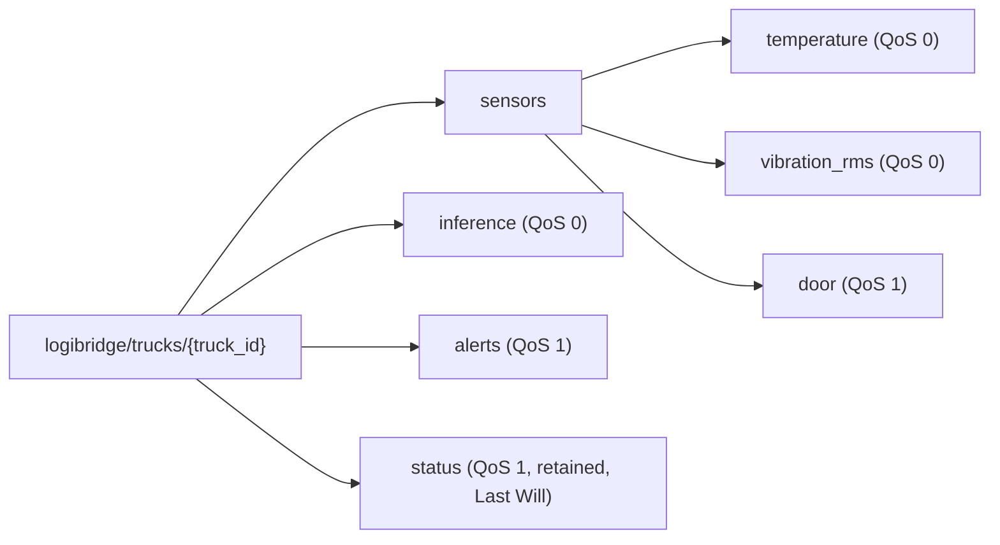

# MQTT Architecture (Task C1)

## 1. Broker and sessions
- Mosquitto runs on the edge node and listens only on 127.0.0.1:1883, so raw
  sensor streams never leave the truck (verify with `ss -ltn | grep 1883`).
- Sensor-to-broker and inference-to-broker traffic stays on the loopback
  interface of the same device, so packet loss between these clients is
  negligible.
- The uplink agent that forwards alerts to the operations centre uses a
  persistent session (clean_session=false, fixed client ID) with QoS 1, so
  queued alerts survive coverage gaps of 35-90 minutes.

## 2. Topic tree

## 3. Topics, payloads and QoS
| Topic (under logibridge/trucks/{truck_id}/) | Publisher -> subscriber | Rate | QoS | Retain | Payload |
|---|---|---|---|---|---|
| sensors/temperature | simulator -> preprocessing | 1 Hz | 0 | no | {"ts":..., "value":4.12} |
| sensors/vibration_rms | simulator -> preprocessing | 0.5 Hz | 0 | no | {"ts":..., "value":0.47} |
| sensors/door | simulator -> preprocessing | on event | 1 | no | {"ts":..., "state":"OPEN"} |
| inference | inference service -> drift monitor | every 10 s | 0 | no | [proposed] ts, class, confidence, probs, latency_ms, model version |
| alerts | inference service -> local alert log, uplink agent | on Warning/Critical | 1 | no | [proposed] alert_id, truck_id, ts, class, confidence |
| status | every client -> any subscriber | on change | 1 | yes | {"state":"online"} or {"state":"offline"} |

The truck ID is in the topic for sensor streams, so it is not repeated in each
payload. Alerts leave the truck, so they carry truck_id themselves.
[Finalise the inference and alert payloads in Step 6.]

## 4. QoS justification
- **temperature, vibration_rms (QoS 0):** high-rate streams that the next
  reading supersedes within 1-2 s. Delivery is over loopback, and QoS 1
  would add an acknowledgement per message plus an in-flight queue that can
  grow if the broker stalls. A lost sample is harmless because the pipeline
  uses a 5-sample moving average over 30 s windows.
- **door (QoS 1):** rare discrete events whose loss would corrupt the door-state
  history and the audit trail. At-least-once is enough, since a duplicate
  OPEN or CLOSE with the same timestamp is harmless.
- **inference (QoS 0):** periodic results replaced every 10 s. The drift
  monitor works on the distribution of the last 100 results, so it tolerates
  an occasional loss.
- **alerts (QoS 1):** the safety-critical messages must arrive at least once,
  including after an outage. QoS 2 is not used: its four-message handshake
  adds round trips on a high-latency rural link, and exactly-once handling is
  achieved more cheaply with a unique alert_id that the operations centre
  uses to discard duplicates.
- **status (QoS 1, retained, Last Will):** a late subscriber immediately sees
  whether a client is online, and the broker publishes "offline" if the
  client dies without disconnecting.

## 5. Subscriber note
The delivered QoS is the lower of the publisher's and the subscriber's
requested QoS. Subscribers to door and alerts must therefore subscribe with
QoS 1, otherwise the QoS 1 guarantee is silently downgraded.

## 6. Hygiene
- Subscribers use specific filters (for example
  `logibridge/trucks/+/sensors/#`), never `#` on the whole broker.
- Payloads are compact JSON (no extra whitespace) to limit bytes.
